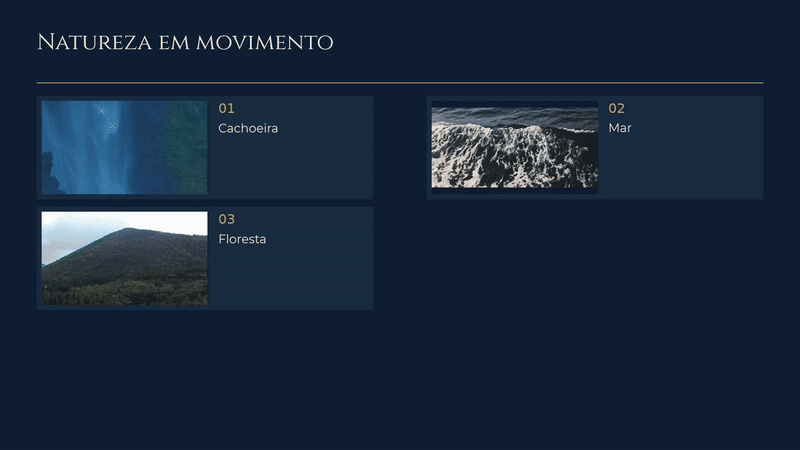
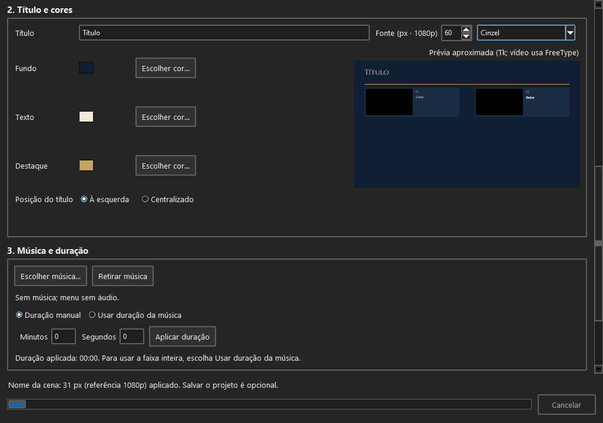

# Gerador de menus em vídeo

Aplicativo desktop para criar um vídeo de apresentação com pequenas prévias das filmagens, nomes das cenas, título e música opcional. A pessoa escolhe os trechos, ajusta a aparência e exporta um arquivo MP4 ou AVI.



*Exemplo realmente exportado pelo programa. As cenas são sintéticas, criadas para a demonstração; não são filmagens de cliente.*

[Ver imagem em resolução completa](docs/assets/menu-gerado.png) · [Ver arquivo MP4 de exemplo](docs/assets/exemplo-menu.mp4)

## Por que criei este projeto

O projeto nasceu de uma necessidade real: preparar um menu visual para apresentar diferentes partes de uma filmagem, sem montar cada composição manualmente num editor de vídeo.

Desenvolvi a solução com apoio de ferramentas de IA. Meu trabalho incluiu entender a necessidade, definir o funcionamento, testar o programa e orientar os ajustes a partir do uso e do retorno recebido.

O resultado é um vídeo linear. **Não é um menu clicável:** não tem botões e não abre outras filmagens. O aplicativo também não altera nem organiza os arquivos originais.

## O que ele faz

- Reúne de uma a seis prévias em movimento no mesmo menu.
- Permite escolher o trecho de cada vídeo e mudar a ordem e o nome das cenas.
- Personaliza título, cores, alinhamento e fontes, com tamanhos independentes para título e cenas.
- Trabalha com duração manual ou duração da música selecionada.
- Salva o projeto para continuar depois e exporta MP4 ou AVI em 1080p.
- Mostra o andamento por etapa e permite cancelar o processamento.
- Evita substituir vídeos já existentes: pela interface, escolhe um nome numerado quando necessário.

## Interface do aplicativo



*Captura real de um teste da versão 1.0.3 no Windows, com conteúdo sintético. A miniatura da interface é uma aproximação do resultado exportado.*

Na interface, **Aplicar nome e trecho** confirma as mudanças da cena selecionada; **Aplicar duração** confirma o tempo do menu.

## Como experimentar

### No Windows

A versão portátil dispensa instalar Python. É preciso extrair a pasta inteira e abrir `Sistema-Menu-Anisio.exe`. Na primeira abertura, o programa pede autorização para baixar as ferramentas de vídeo; depois pode reutilizar o cache verificado sem rede.

O pacote do aplicativo é separado do código-fonte. **O ZIP do botão Code não é o programa pronto para abrir.** A publicação do pacote Windows neste repositório ainda está pendente.

[Instruções para o pacote Windows](docs/USO-WINDOWS.md)

### Pelo código-fonte

Pré-requisitos: Python 3.11 ou superior, Tkinter com ambiente gráfico e FFmpeg/ffprobe no PATH. O FFmpeg deve ter libx264, AAC e drawtext; o filtro scale precisa suportar `reset_sar` (a demonstração deste repositório usa FFmpeg 9).

A aplicação usa a biblioteca padrão do Python; não exige instalar pacotes com pip para executá-la.

```sh
python menu_gui.py
```

Depois de salvar um projeto pela interface, também é possível exportar pela linha de comando:

```sh
python menu_anisio.py projeto.menu --saida menu.mp4 --perfil 1080p
```

[Guia de uso e cuidados com os arquivos](docs/GUIA-DE-USO.md)

## Como o código está organizado

- `menu_gui.py`: janela, controles e interação com o usuário.
- `gui_autoria.py`: estado do projeto e validação das escolhas.
- `gui_servicos.py`: leitura, gravação e integração entre interface e processamento.
- `menu_anisio.py`: composição do menu e exportação com FFmpeg.
- `gui_trabalho.py` e `media_runtime.py`: trabalhos em segundo plano, processos e cancelamento.
- `font_families.py` e `font_assets/`: catálogo, arquivos e verificação das fontes.
- `tests/`: testes automatizados, incluindo uso de mídias sintéticas.
- `windows_build/`: preparação e verificação do pacote Windows.

Mantive os nomes técnicos históricos de alguns arquivos para preservar a versão do aplicativo, mesmo usando um título mais descritivo nesta apresentação.

## Testes e limites

```sh
python -B -m unittest discover -s tests -v
```

A versão portátil 1.0.3 tem evidências anteriores de execução no Windows, incluindo abertura da interface e exportações com o executável. Essa evidência é diferente dos testes desta seleção de fontes para apresentação.

O programa não promete compatibilidade com toda TV ou todo arquivo de vídeo. A prévia tipográfica da interface é aproximada. A primeira abertura do pacote Windows precisa de rede e consentimento para o download das ferramentas. O código das fontes não foi transformado em uma versão de navegador.

[O que foi verificado e o que continua limitado](docs/VALIDACAO.md) · [Preparação do pacote Windows](BUILD-WINDOWS.md)

## Componentes de terceiros

As fontes incluídas mantêm seus arquivos OFL. FFmpeg é uma ferramenta externa, e o pacote Windows conserva os avisos dos componentes de runtime.

[Licenças, atribuições e distribuição](docs/TERCEIROS.md)
